# 近传 · NearSend

**手机 ⇄ 电脑，同一个 Wi-Fi 直传文字、图片和文件。** 不登录、不上云、不压缩，也不经过任何中转服务器。

电脑端是一个常驻托盘的 Windows 程序；手机端有两种用法：**扫码即用的网页版**（不装 App）和 **Android App**（配对一次之后点一下就连）。

| 手机首页 | 聊天 | 设置 | 后台通知 |
|---|---|---|---|
| 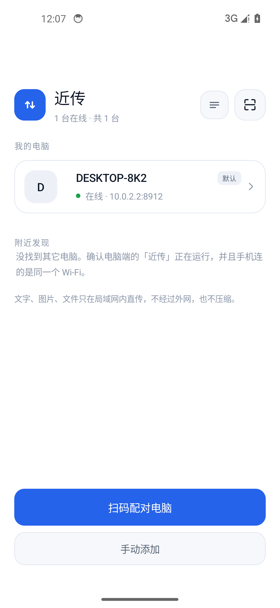 | 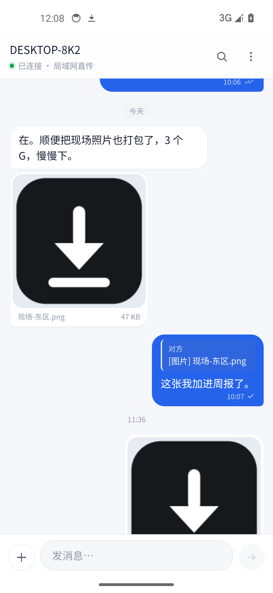 | 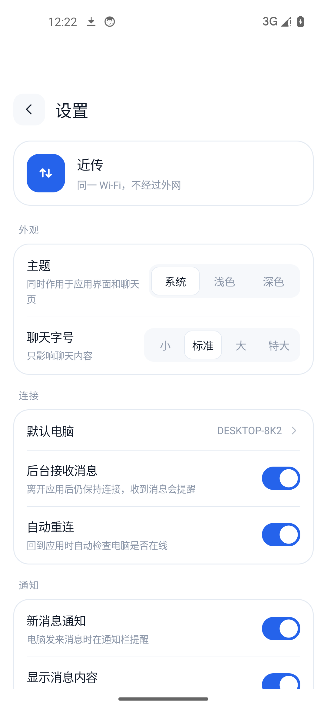 | 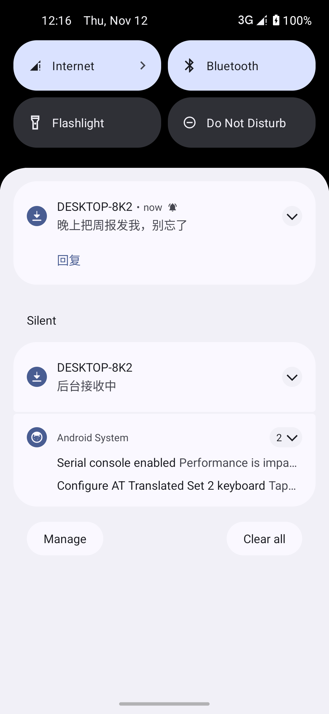 |

电脑端常驻托盘，小窗只放一张二维码：


---

## 它解决什么问题

- 微信文件传输助手要联网、要登录，图片还会被压缩。
- 手机收了个大文件想丢给电脑，数据线找不到，网盘上传下载绕两遍。
- 公司电脑不让装微信/QQ，但手机和电脑就在同一个网段。

近传把电脑变成一个只在局域网里可见的接收端：手机扫码就能发东西过去，电脑也能往回发。**离开这个 Wi-Fi 就传不了**，这正是它的隐私边界。

---

## 两种用法

**免安装（网页版）**
电脑上打开近传 → 手机相机扫窗口里的二维码 → 浏览器直接进聊天页。iOS / Android 都行，Safari / Chrome 里「添加到主屏幕」之后有图标、全屏、离线打开，和原生几乎一样。

**Android App**
扫码或手动填地址配对一次，电脑就留在设备列表里。之后打开 App 点一下卡片就连上，不用每次扫码。额外多了系统分享入口、通知栏直接回复和后台接收。

---

## 手机端功能

### 聊天

- 文字、图片、文件双向收发，支持视频直接播放
- **已送达 / 已读**双勾回执（电脑读到消息后回传）
- **引用回复**：长按任意消息 → 回复，气泡里带原文，点引用可跳回原消息
- **搜索**：搜文字和文件名，命中高亮，上下跳转
- **多选删除**：批量清理，两端同步
- 长文折叠、链接自动识别、日期与时间分隔
- **草稿**保留（按电脑区分）、断网时进入**待发送队列**，连上自动补发
- 发送失败可重试，上传中显示百分比、速度和剩余时间

### 媒体

- 大图查看：双指缩放、双击放大、左右滑动切换、保存到相册、分享到其他应用
- 图片可设置为**后台收到自动存相册**
- 文件保存在「下载/NearSend」，随时可以在系统下载里找到

### 传输与下载：谁负责什么

| 场景 | 行为 |
|---|---|
| 电脑 → 手机 图片 | 聊天里直接显示缩略图；**默认不自动存**，点图片看大图后保存，或开启「自动保存收到的图片」让后台收到就存 |
| 电脑 → 手机 文件 | **默认不自动下载**，点一下文件卡片 → 保存到手机；进度、速度、剩余时间显示在卡片下方，通知栏也有进度，可在通知或系统「下载」里取消 |
| 手机 → 电脑 | 电脑端立即落盘，手机气泡下方显示上传进度、速度与剩余时间 |
| 电脑端看手机下载 | 手机正在下载电脑上的文件时，电脑气泡显示「手机下载中 42%」，完成后显示「手机已下载」 |
| 下载完成后 | 图片进相册「近传」，文件进「下载/NearSend」；系统通知点一下直接打开 |

> 手机端不保存聊天记录：消息只存在电脑上。手机只存电脑地址、访问令牌和界面偏好，以及你明确保存过的图片/文件。

### 下载与进度

- 发送大文件时，气泡下方有**进度条 + 百分比 + 速度 + 剩余时间**
- 下载时同样有进度条，可在气泡里**取消**，完成后可**直接打开**
- 通知栏同步显示下载进度（系统下载管理器），完成后点击通知即可打开文件
- 设置 → 传输 → **下载管理** 可直达系统的下载列表

### 系统集成（Android App）

- **从任意应用分享到近传**：相册、文件管理器、浏览器里选中内容 → 分享 → 近传 → 选电脑 → 直接上传
- **通知栏直接回复**：不用先打开 App
- 桌面图标长按 → 扫码配对
- 返回键优先关闭预览 / 弹层 / 搜索 / 多选，再退出页面；键盘弹着时只收键盘

### 设置（完整设置页）

| 分组 | 内容 |
|---|---|
| 外观 | 主题（跟随系统 / 浅色 / 深色）、聊天字号（小 / 标准 / 大 / 特大） |
| 连接 | 默认电脑、后台接收消息、自动重连 |
| 通知 | 新消息通知、消息内容预览、震动提醒 |
| 传输 | 自动保存收到的图片、保存位置 |
| 数据 | 清空电脑端聊天记录、移除所有配对、隐私说明 |
| 支持 | 帮助与诊断、版本号、开源许可 |

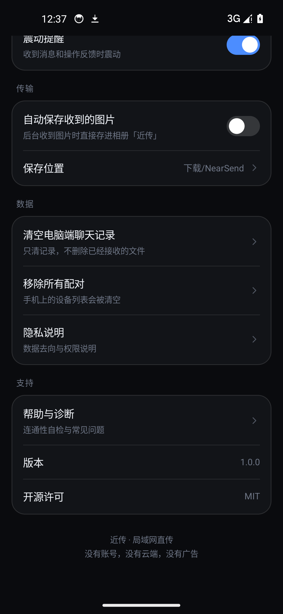

### 帮助与诊断

内置连通性自检：当前网络类型、手机 IP、电脑地址、端口可达性、令牌是否有效、电脑名称，并一键复制诊断信息。下面是按顺序排列的排查步骤和六条常见问题（防火墙、AP 隔离、令牌失效、后台收不到、语音输入、数据去向）。

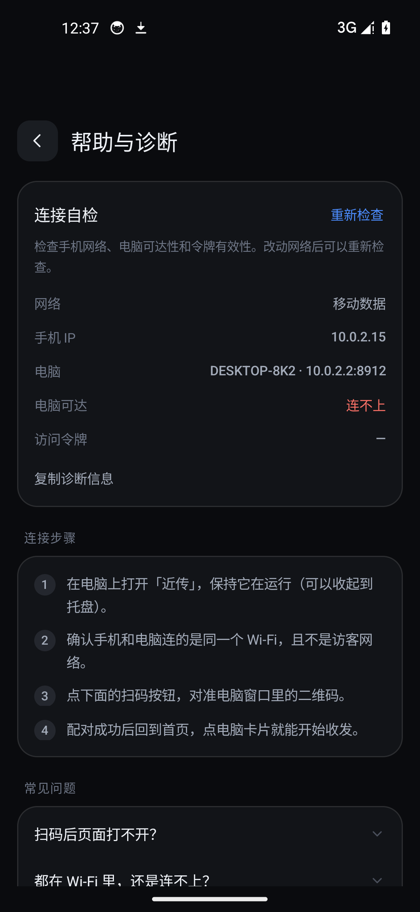

---

## 更多界面

| 首次引导 | 手动配对 | 长按菜单 |
|---|---|---|
| 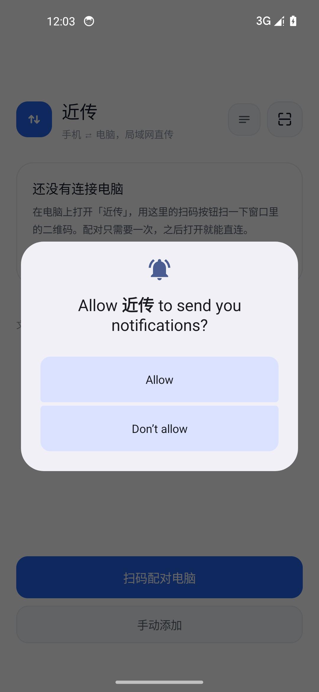 | 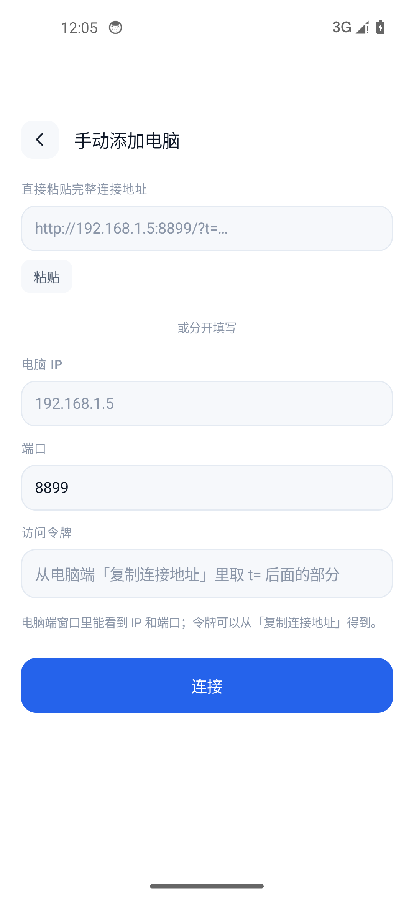 | 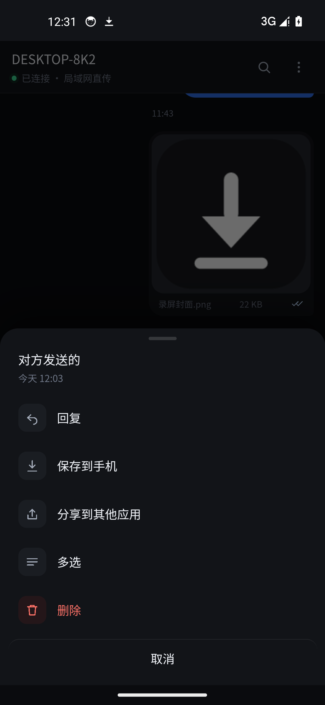 |

| 大图查看 | 系统分享 | 聊天设置 |
|---|---|---|
| 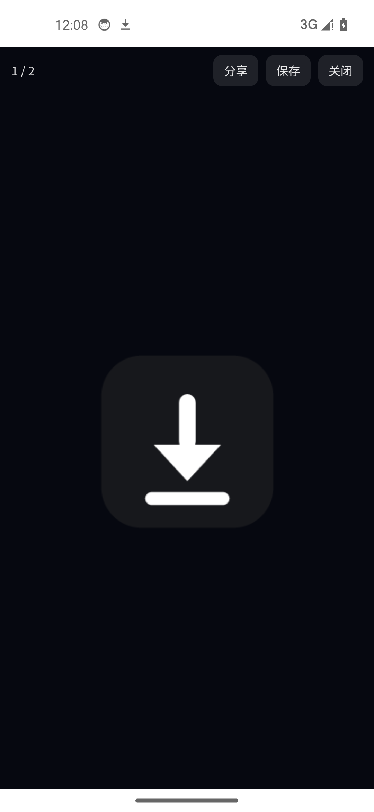 | 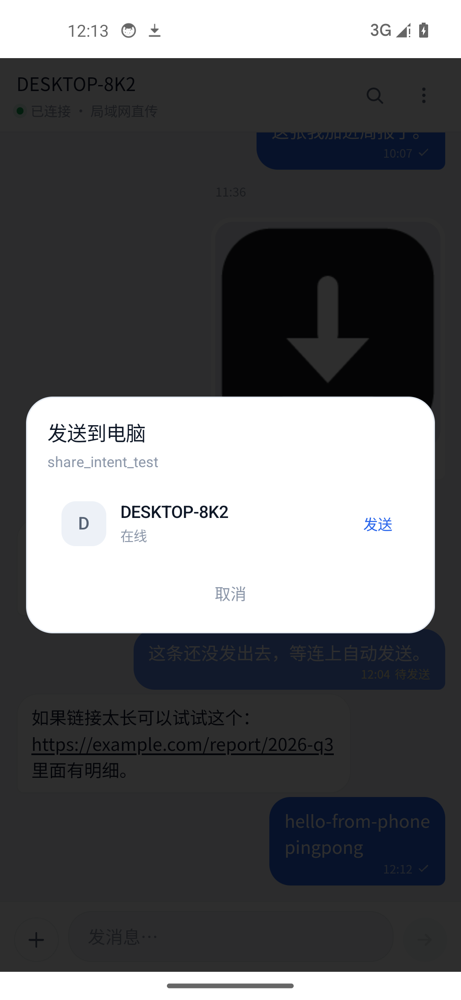 | 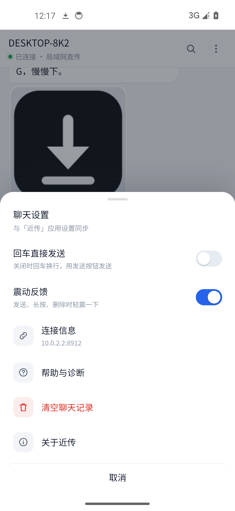 |

深色主题、网页版：

| 深色首页 | 网页版聊天 | 网页版搜索 |
|---|---|---|
| 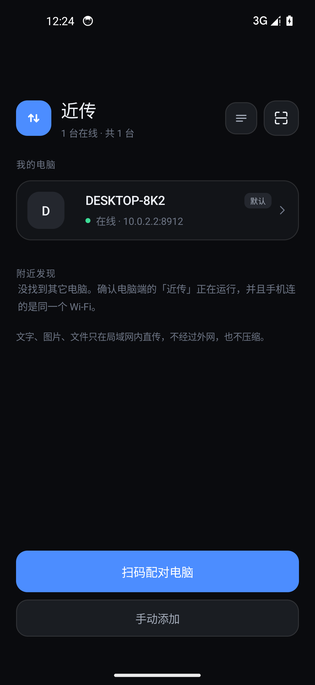 | 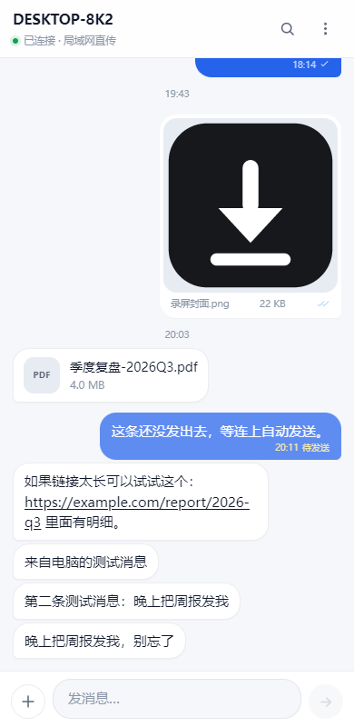 | 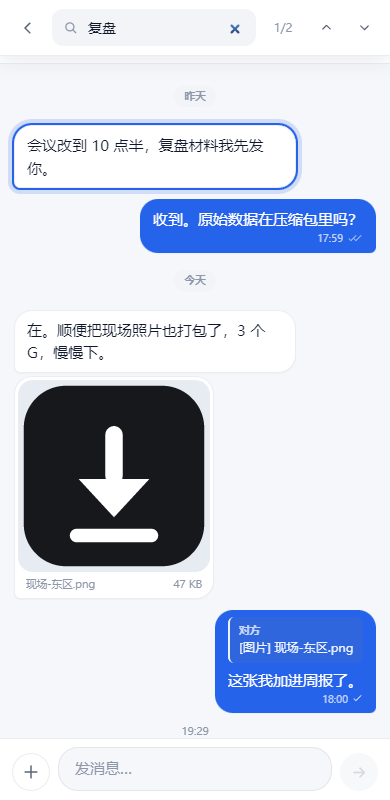 |

网页版的聊天设置与主题（不装 App 时可用）：

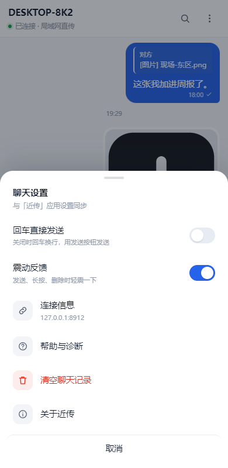

---

## 安装

### Android

产物：`dist/NearSend-Android-2.0.0.apk`（约 3.5 MB，已签名，versionCode 4）

- Android 7.0（API 24）及以上
- 直接拷到手机安装；首次安装需要在系统里允许「安装未知来源应用」
- 覆盖升级必须使用同一签名，否则要先卸载
- **包名已改为 `com.nearsend.app`**：装过旧版「局域网传信」（`com.landrop.app`）的手机请先卸载旧版，否则两个应用会同时存在。旧版里的配对记录不会自动带过来，重新扫一次码即可
- 手机端的聊天界面由电脑端实时下发，**电脑端升级到 2.0.0 后，手机不用重装 App 就能用上「发不出去」的修复**

### Windows

| 文件 | 说明 |
|---|---|
| `NearSend-2.0.0-Setup.exe` | 推荐。完整安装向导：许可协议 → 安装模式 → 安装位置 → 开机启动 → 快捷方式，装到 `%LOCALAPPDATA%\Programs\NearSend` |
| `NearSend-2.0.0-Portable.exe` | 便携版，单文件免安装 |

系统要求：Windows 10 / 11（x64）。

安装向导要点：

- 安装前**自动结束正在运行的旧实例**（托盘常驻程序会锁住 exe），不需要手动退出
- 可选「开机时自动启动近传」，装完即可用；也可以随时在程序设置里改
- 创建桌面与开始菜单快捷方式「近传」，卸载项显示「近传 NearSend 2.0.0」

安装包会自动处理版本关系：

- 已装旧版近传 → 就地覆盖升级，不打断
- 已装旧品牌 LanDrop（v1.1.0 及更早）→ 先静默卸载旧程序，再安装，**电脑里只保留一个近传**
- 版本相同 → 视为修复安装
- 只有安装包确实比已装版本旧时，才会提示「装回旧版」

> 从旧品牌 LanDrop 升级时，首次启动会自动把 `%APPDATA%\LanDrop` 里的聊天记录和配置迁移到新目录
> （含 Electron 的 `Local State` 解密密钥），配对过的手机不用重新扫码。

### 电脑上已经有两个版本，怎么清干净

先装 `NearSend-2.0.0-Setup.exe`（它会顺带卸掉 LanDrop）；如果旧版还在，按下面手动清理一次：

1. 打开「设置 → 应用 → 已安装的应用」，卸载所有名字含 **LanDrop**、**局域网传信** 的条目
2. 只保留 **近传 NearSend** 一项，版本显示 2.0.0
3. 检查这两个目录，旧品牌目录可以删：`%APPDATA%\LanDrop`（聊天记录，删前先在程序里确认已迁移）、
   `%LOCALAPPDATA%\Programs\LanDrop`

详细说明见 [docs/UPGRADE.md](docs/UPGRADE.md)。

---

## 快速开始

1. 双击启动电脑端，程序常驻托盘。
2. 点托盘图标弹出小窗，窗口里是一张二维码。
3. 手机端任选一种：
   - 系统相机扫码，浏览器打开即用；
   - Android App 里点「扫码配对电脑」；
   - App 里「手动添加」粘贴完整地址，或填 IP / 端口 / 令牌。
4. 配对成功后，手机首页点电脑卡片进入聊天，开始收发。

---

## 隐私与安全

| 项 | 做法 |
|---|---|
| 访问控制 | 二维码里带随机 token；请求校验 Host 白名单，防 DNS rebinding；手机端把 token 存进本地 |
| 聊天的存放 | 只在电脑上，AES-256-GCM 逐条加密，密钥由 Windows DPAPI 绑定当前账户 |
| 手机端存什么 | 只存电脑地址、令牌和界面偏好；聊天内容不落手机（图片/文件除外，且由你决定是否保存） |
| 网络 | 不访问外网，没有账号体系，没有遥测和更新检查 |
| 传输 | 局域网内明文 HTTP 直连。传输不经过外网，但如果局域网本身不可信，请自行评估 |

换了 Windows 账户或换了电脑，电脑端聊天记录将无法解密。程序不会删除数据，会把原文件改名为 `messages.locked-<时间戳>.jsonl` 保留在原地。

---

## 常见问题

**扫码后页面打不开？**
多半是 Windows 防火墙拦了。电脑端「设置 → 连接 → 防火墙 放通」，同意一次 UAC 即可。

**都连着 Wi-Fi 还是连不上？**
路由器开了 **AP 隔离** 或访客网络。这类网络禁止设备互访，程序层面无解；换主网络或用手机热点。

**端口被占用？**
从 8899 开始自动向后找可用端口，二维码里始终是实际端口，不需要手动改。

**后台收不到消息？**
确认「设置 → 后台接收消息」开启，并在系统里允许近传自启动和后台运行（MIUI / EMUI / ColorOS 限制较多）。通知权限被关掉也不会提醒。

**手机端为什么没有语音输入按钮？**
局域网页面是明文 HTTP，浏览器不允许网页调用麦克风。用输入法自带的语音键转成文字即可。

**提示「令牌已失效」？**
电脑端重置过连接令牌。重新扫一次二维码即可，不用删数据。

---

## 从源码构建

### 电脑端

```bash
npm install
npm run dist        # 产出便携版与安装包到 dist/
```

国内网络可加镜像：

```bash
ELECTRON_BUILDER_BINARIES_MIRROR=https://npmmirror.com/mirrors/electron-builder-binaries/ npx electron-builder --win portable nsis
```

### Android

需要 JDK 17、Android SDK（platform 34、build-tools 34+）、Gradle 8.7：

```bash
cd android
export JAVA_HOME="<你的 JDK 17>"
gradle assembleRelease
# 产物：app/build/outputs/apk/release/app-release.apk
```

`android/gradle.properties` 里已打开 `android.overridePathCheck=true`（项目路径含中文）。

---

## 目录结构

```
src/main/            Electron 主进程
  main.js            窗口、托盘、IPC、通知、数据迁移
  server.js          HTTP/WS 服务、鉴权、分片上传、文字快捷接口
  store.js           消息存储（加密 JSONL）
  uploads.js         分片落盘
src/renderer/
  desktop/           电脑端界面
  mobile/            手机端聊天页（服务端直接吐出，App 也用这一份）
android/app/         Android 客户端（WebView 容器 + 原生能力）
  java/com/nearsend/app/
    MainActivity         设备列表、发现、配对入口
    ChatActivity         WebView 容器、下载、返回键、主题注入
    SettingsActivity     完整设置页
    HelpActivity         连接自检与常见问题
    OnboardingActivity   首次引导
    ShareActivity        系统分享入口
    Bridge               网页能力桥（剪贴板/保存/分享/震动/状态栏）
    LinkService          前台服务、后台接收、通知与快捷回复
    Uploader/Downloader  原生分片上传、保存与分享
docs/                产品文档与截图
tools/               图标生成、截图、演示服务器（不参与打包）
```

技术栈：Electron 28 + 内嵌 Node http/ws + 原生 HTML/CSS/JS；Android 侧为原生 Java + WebView，无前端框架、无构建步骤。

---

## 文档

- [产品定义与竞品对照](docs/PRODUCT.md)
- [从旧版本升级到 2.0.0](docs/UPGRADE.md)
- [2.0.0 交付验证记录](docs/VERIFY-2.0.0.md)
- [Android 客户端说明](android/README.md)
- [更新日志](CHANGELOG.md)

## 许可证

本项目未声明开源许可证，保留所有权利。
