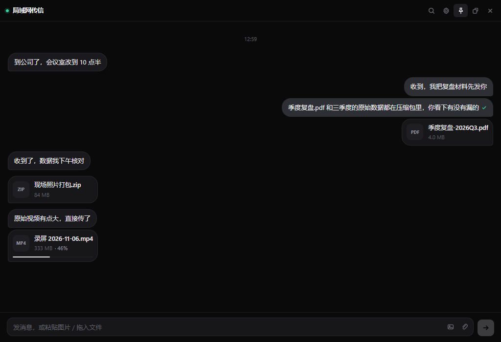
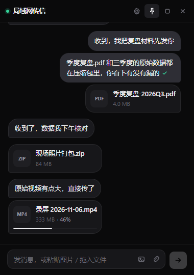
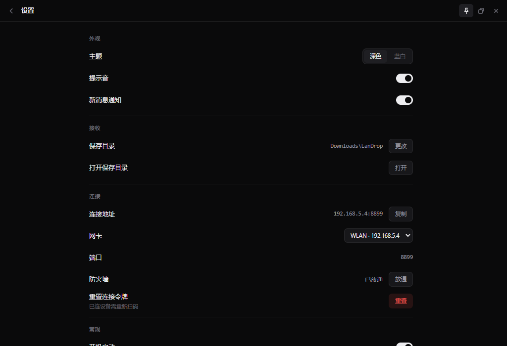

# 局域网传信 · LanDrop

**手机扫码即连，不装 App、不插线、不上云。** 在同一个 Wi-Fi 下传文字、图片、文件，数据只在你的路由器和电脑之间流转。

Windows 桌面程序，手机端是一个网页——扫码直接打开，可以「添加到主屏幕」当 App 用。



---

## 它解决什么问题

- 会议里想把手机截图弄到电脑，微信文件传输助手要联网、要登录、还会压缩。
- 手机上收到一个大文件想丢给电脑，数据线找不到，网盘又要上传下载两遍。
- 公司电脑不让装微信/QQ，但手机和电脑在同一网段。

LanDrop 只做一件事：把这台电脑变成一个只在局域网内可见的接收端，手机扫码就能发东西过去，电脑也能往回发。

| 小窗（未连接） | 小窗（已连接） | 设置页 |
|---|---|---|
|  |  |  |

---

## 为什么是它

**手机端零安装**
不用下 App、不用注册。扫码打开网页就能发消息，iOS/Android 都能用；「添加到主屏幕」之后图标、全屏、离线打开都和原生一样。

**数据不出局域网**
没有中转服务器，没有账号体系，不联网也能用。传输走的是 `192.168.x.x` 到你电脑的本机端口。

**大文件真能传**
4MB 分片顺序直传，锁屏断了重连能接着传；传输中显示实时速度和剩余时间。3GB 的视频也只是一条进度条的事。

**聊天记录加密**
AES-256-GCM 逐条加密，密钥由 Windows DPAPI 绑定当前账户。别人把你的数据目录拷走也打不开。

**该有的交互都有**
未读计数、托盘红点、系统通知、已送达回执、失败重试、多选删除、会话内搜索、输入草稿、图片点击放大、拖动窗口、置顶、深浅两套主题。

---

## 下载与安装

| 文件 | 说明 |
|---|---|
| `LanDrop-<版本>-Setup.exe` | **推荐**。安装版，装到 `%LOCALAPPDATA%\Programs\LanDrop`，带开始菜单和卸载项 |
| `LanDrop-<版本>-Portable.exe` | 便携版，单文件免安装，双击即用 |

系统要求：Windows 10 / 11（x64）。

**关于更新**：装过旧版本后，直接运行新版安装包，它会读取当前已安装的版本并弹窗确认——更旧的版本提示「将更新到 x.x.x」，更新的版本提示是否降级。没装过则直接进入安装流程。两者共用同一份数据目录，升级不会丢聊天记录。

---

## 怎么用

1. 双击启动，程序常驻右下角托盘，不会占任务栏。
2. 点托盘图标（或双击 exe）弹出小窗，窗口里是一张二维码。
3. 手机相机对着扫，浏览器自动打开对话页。
4. 直接发文字、图片、文件；电脑端在同一个小窗里回复。

### 快捷键与操作

| 操作 | 说明 |
|---|---|
| `Enter` | 发送 |
| `Shift + Enter` | 换行 |
| `Ctrl + V` | 粘贴剪贴板里的图片直接发送 |
| 拖拽文件到窗口 | 直接发送 |
| 右键消息 | 复制文字 / 复制图片 / 打开 / 显示所在文件夹 / 另存为 / 多选 / 删除 |
| 点击图片 | 从缩略图位置放大预览 |
| `Esc` | 关闭预览、退出搜索、退出设置、还原小窗 |

窗口可以拖动位置，但尺寸固定——小窗 380×540，主界面 1120×780，不会因为误拖改变布局。

---

## 功能清单

**传输**
- 文字、图片、任意文件双向传输
- 4MB 分片、断点续传、实时速度与剩余时间
- 图片缩略图、点击放大、另存为、复制到剪贴板
- 文件打开 / 在资源管理器中定位 / 另存为

**会话**
- 消息分组、时间分隔、已送达回执
- 未读计数 + 托盘图标红点 + 系统通知（可关）
- 消息多选批量删除、会话内搜索（最近 500 条）
- 输入草稿自动保存

**状态**
- 在线绿灯、断线提示条、一键重新扫码
- 手机锁屏断开后自动重连，重连成功有提示音和动画
- 连接、发送、接收三种提示音（可关）

**窗口**
- 小窗 / 主界面两种固定尺寸，可拖动、可置顶
- 托盘菜单：最大化 / 设置 / 退出

---

## 隐私与安全

| 项 | 做法 |
|---|---|
| 访问控制 | 二维码里带随机 token，URL 直接打开才有效；请求校验 Host 白名单，防 DNS rebinding |
| 聊天记录 | AES-256-GCM 逐条加密，密钥由 Windows DPAPI 绑定当前账户 |
| 接收的文件 | **不加密**，保存在你指定的目录，随时可以双击打开 |
| 配置文件 | 明文，只有 token 和界面偏好，不含聊天内容 |
| 网络 | 不访问外网，没有任何遥测和更新检查 |

换了 Windows 账户或换了电脑，聊天记录将无法解密。程序不会删除数据，会把原文件改名为 `messages.locked-<时间戳>.jsonl` 保留在原地。

---

## 常见问题

**手机扫码后打不开页面？**
Windows 防火墙拦了。设置页 →「连接」→「防火墙 放通」，会弹 UAC 授权，允许一次即可。也可以在首次运行时直接同意系统弹出的防火墙提示（勾选专用网络）。

**手机和电脑都连着 Wi-Fi，还是连不上？**
多半是路由器的 **AP 隔离** 或 **访客网络** 打开了——这类网络禁止设备之间互访，程序层面无解。换到主网络，或用手机热点让电脑连上。

**端口被占用怎么办？**
程序会从 8899 开始自动向后找可用端口，二维码里的地址始终是实际端口，不需要你手动改。

**提示「聊天记录无法解密」？**
密钥绑定了原来的 Windows 账户。换账户/换机器后无法恢复，原文件会以 `messages.locked-*.jsonl` 保留。

**手机端没有语音输入按钮？**
局域网是 HTTP 页面，浏览器不允许网页调用麦克风（安全上下文限制）。请用手机输入法自带的语音键，转成文字后正常发送即可。

---

## 从源码构建

```bash
# 需要 Node.js 18+
npm install
npm run dist        # 同时产出便携版与安装包到 dist/
```

国内网络建议加镜像：

```bash
ELECTRON_BUILDER_BINARIES_MIRROR=https://npmmirror.com/mirrors/electron-builder-binaries/ npx electron-builder --win portable nsis
```

### 目录结构

```
src/main/          Electron 主进程
  main.js          窗口、托盘、IPC、通知
  server.js        内嵌 HTTP/WS 服务、鉴权、分片上传
  store.js         消息存储（加密 JSONL）
  crypto.js        密钥与加解密封装
  uploads.js       分片落盘与断点续传
  config.js        配置读写
src/preload/       contextBridge 暴露的安全接口
src/renderer/
  desktop/         电脑端界面
  mobile/          手机端网页（服务端直接吐出）
assets/            图标与 NSIS 安装脚本
tools/             截图与图标生成脚本（不参与打包）
```

技术栈：Electron 28 + 内嵌 Node http/ws + 原生 HTML/CSS/JS，没有前端框架，没有构建步骤。

---

## 版本策略

语义化版本，每次发布同步更新 `CHANGELOG.md` 与 Git tag：

- 修 bug → 修订号 `1.1.x`
- 新增功能 → 次版本号 `1.x.0`
- 破坏性变更 → 主版本号 `x.0.0`

## 更新日志

见 [CHANGELOG.md](CHANGELOG.md)。

## 许可证

本项目未声明开源许可证，保留所有权利。
